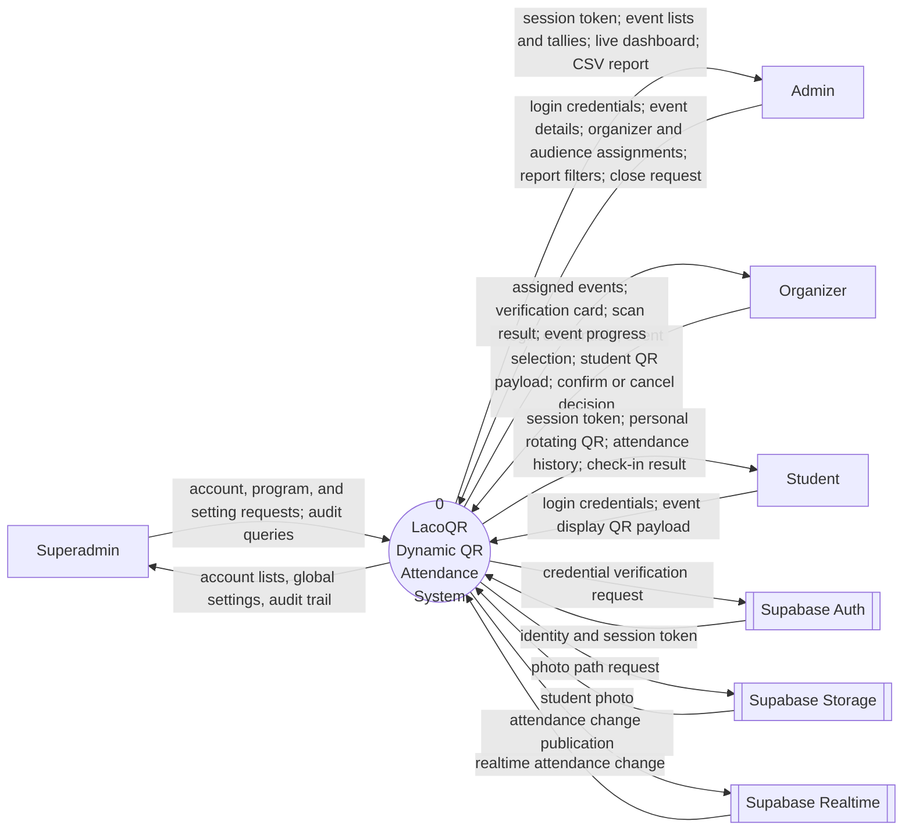
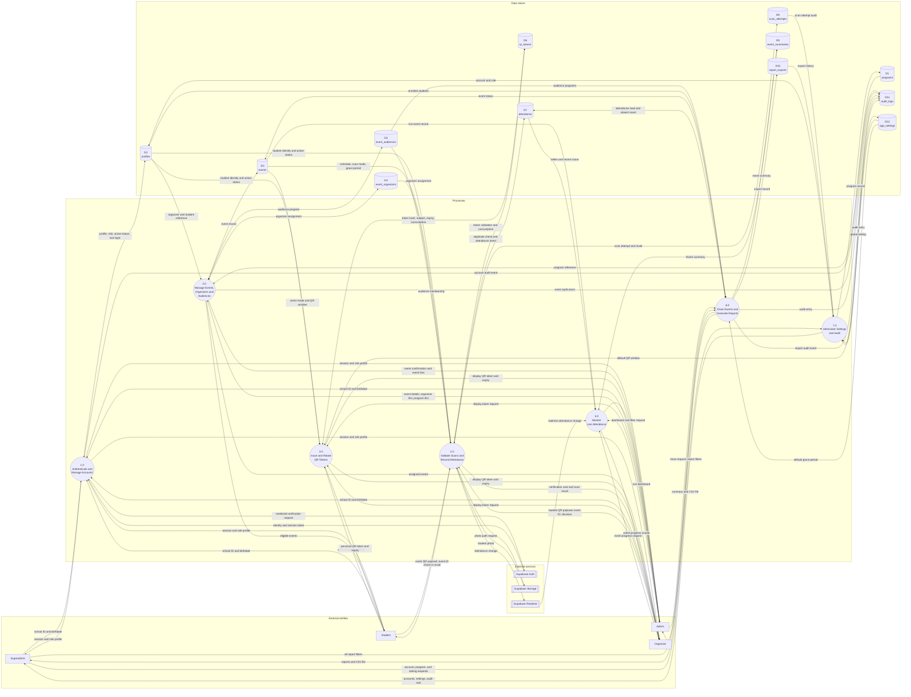
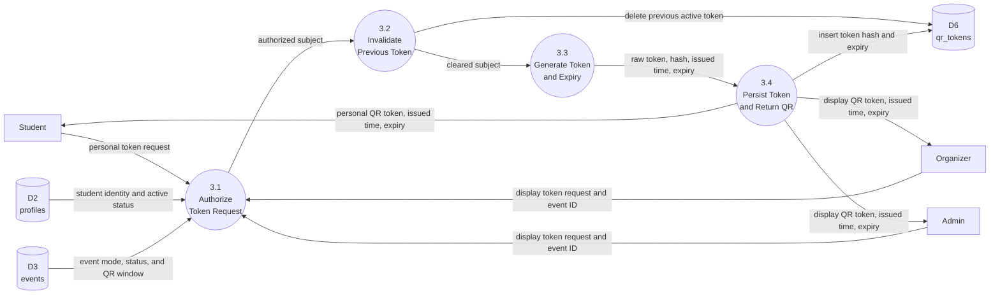
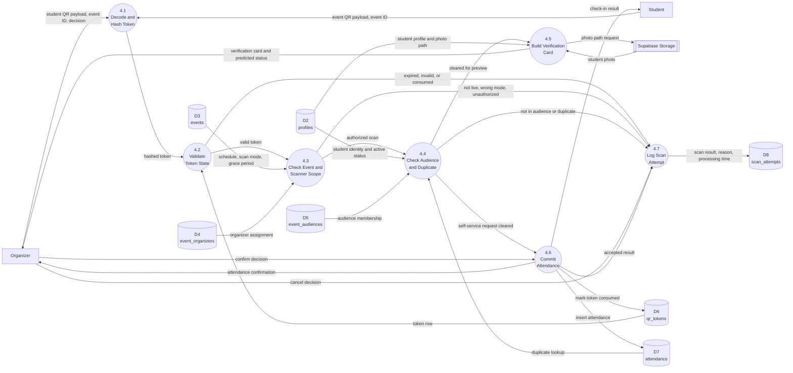
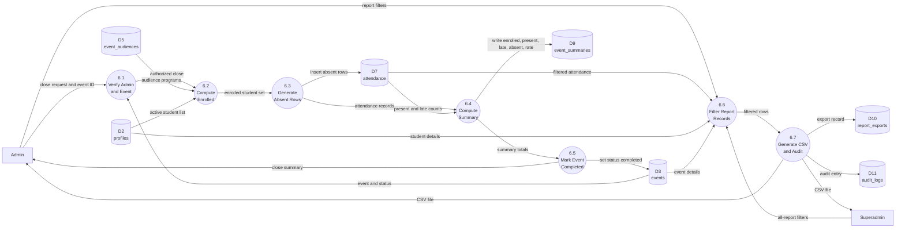

# Context Flow Diagram and Data Flow Diagrams

This document contains the context flow diagram (CFD) and the leveled data flow
diagrams (DFD) for **LacoQR**, the dynamic QR attendance system described in
`docs/PROJECT_ANALYSIS.md` and `docs/DATA_MODEL.md`.

The diagrams are written in Mermaid so they can be version-controlled, reviewed
in a pull request, and exported to PNG for the manuscript. Every diagram is
followed by the tables a panel normally asks for: external entities, processes,
data flows, and data stores.

**Sources used**

- `Dynamic QR Attendance.pdf` (thesis proposal)
- `docs/PROJECT_ANALYSIS.md` (requirements)
- `docs/DATA_MODEL.md` (entities and rules)
- `backend/src/routes/` and `backend/src/services/` (implemented behavior)
- `supabase/migrations/0001_schema.sql` (physical tables)

---

## 1. Notation and conventions

The diagrams use **Yourdon/DeMarco** notation.

| Symbol | Meaning | Mermaid shape used |
| --- | --- | --- |
| Rectangle | External entity (person, role, or external service) | `[Entity]` |
| Circle | Process (numbered `n.0`, `n.m`) | `((Process))` |
| Open-ended rectangle | Data store | `[(Dn store)]` (cylinder is the closest Mermaid shape) |
| Labeled arrow | Data flow | `-->` with a quoted edge label |
| Double-bordered box | External service outside the system boundary | `[[Service]]` |

**Conventions**

- Process numbers follow the hierarchy: `0` is the context process, `1.0` to
  `7.0` are the Level 1 processes, and `3.1`, `4.2`, `6.3` are Level 2
  sub-processes.
- Data stores are numbered `D1` to `D12` and keep the same ID in every diagram.
- A flow is named after the data that moves, not after the action that moves it.
- A store arrow marked "read/write" covers both a read flow and a write flow.
- The external entity **Supabase Auth** owns credentials. **Supabase Storage**
  owns student photos. **Supabase Realtime** pushes attendance changes to the
  live dashboard. All three are outside the system boundary even though they are
  hosted by the same provider.
- `superadmin`, `report_exports`, `audit_logs`, and `app_settings` are documented
  as proposed in `docs/DATA_MODEL.md`; the diagrams include them because they are
  part of the target scope.

---

## 2. System boundary and actors

**Inside the boundary:** the LacoQR web dashboard, mobile app, Express REST API,
token service, attendance service, and the Supabase Postgres database.

**Outside the boundary:** the four human roles, Supabase Auth, Supabase Storage,
and Supabase Realtime.

| Actor | Platform | Main data handled |
| --- | --- | --- |
| Superadmin | Web | Admin accounts, programs, global settings, audit trail, all reports |
| Admin | Web | Events, organizers, audiences, live dashboard, report filters, CSV exports |
| Organizer | Mobile | Assigned events, student QR payloads, verification decisions |
| Student | Mobile | Personal rotating QR, event display QR payloads, attendance history |

---

## 3. Context flow diagram (CFD / DFD Level 0)

The whole system is one process. The diagram shows only what crosses the system
boundary.

### Figure 1 — Context flow diagram

### Table 1 — External entities

| Entity | Type | Description | Inputs from system | Outputs to system |
| --- | --- | --- | --- | --- |
| Superadmin | Person | Highest-privilege web user | Account lists, programs, settings, audit trail, all reports | Account requests, program data, global settings, audit queries |
| Admin | Person | Event and report manager on the web dashboard | Session, event records, tallies, dashboard, CSV files | Credentials, event details, organizer/audience assignments, filters, close request |
| Organizer | Person | Mobile gatekeeper scanner | Assigned events, verification card, scan result, progress | Credentials, event selection, student QR payload, confirm/cancel |
| Student | Person | Mobile attendee | Session, personal QR, attendance history, result | Credentials, event display QR payload |
| Supabase Auth | External service | Identity provider and credential store | Verification request, refresh request | Identity, access token, refresh token |
| Supabase Storage | External service | Stores student profile photos | Photo path request | Student photo (or signed URL) |
| Supabase Realtime | External service | Pushes database changes to subscribed clients | Attendance change publication | Realtime attendance change event |

### Table 2 — Context-level data flows

| # | Flow | Source | Destination | Composition |
| --- | --- | --- | --- | --- |
| C1 | Account and setting request | Superadmin | 0 LacoQR | Account action, program record, setting key/value, audit filter |
| C2 | Administration result | 0 LacoQR | Superadmin | Account list, program list, settings, audit entries |
| C3 | Admin request | Admin | 0 LacoQR | School ID + birthdate, event fields, organizer IDs, program IDs, report filters, close command |
| C4 | Admin result | 0 LacoQR | Admin | Access token, event list/detail, tally, dashboard rows, CSV file |
| C5 | Organizer request | Organizer | 0 LacoQR | School ID + birthdate, event ID, student QR token, confirm/cancel flag |
| C6 | Organizer result | 0 LacoQR | Organizer | Assigned events, verification card, attendance result, counts |
| C7 | Student request | Student | 0 LacoQR | School ID + birthdate, event ID, event QR token |
| C8 | Student result | 0 LacoQR | Student | Access token, personal QR token + expiry, attendance history, check-in result |
| C9 | Credential verification | 0 LacoQR | Supabase Auth | Synthetic email, derived password, refresh token |
| C10 | Session | Supabase Auth | 0 LacoQR | User ID, access token, refresh token, expiry |
| C11 | Photo request | 0 LacoQR | Supabase Storage | Authenticated photo path or signed URL request |
| C12 | Student photo | Supabase Storage | 0 LacoQR | Image bytes or signed URL |
| C13 | Attendance publication | 0 LacoQR | Supabase Realtime | Inserted or updated attendance row |
| C14 | Realtime change | Supabase Realtime | 0 LacoQR | Attendance change event with row payload |

---

## 4. DFD Level 1

Level 1 opens process `0` into the seven major processes and shows the twelve
data stores.

### Figure 2 — DFD Level 1

> The shaded group boxes are **layout aids** added by the diagram tool. They are
> not Yourdon/DeMarco symbols; the DFD symbols remain the rectangles (external
> entities), circles (processes), and data stores (D1–D12).

### Table 3 — Level 1 processes

| ID | Process | Purpose | Main inputs | Main outputs |
| --- | --- | --- | --- | --- |
| 1.0 | Authenticate and Manage Accounts | Verify school ID + birthdate, issue a session, load role/profile, and enforce active-account rules | Credentials, Auth session, profile row | Access token, role profile, account audit event |
| 2.0 | Manage Events, Organizers and Audiences | Create, edit, cancel, and scope events; assign organizers and audience programs | Event fields, organizer IDs, program IDs | Event record, assignment records, scoped event lists |
| 3.0 | Issue and Rotate QR Tokens | Issue 30-second student and event display tokens, replacing the previous token | Token request, subject identity, event window | Token payload, hash, issued/expiry timestamps |
| 4.0 | Validate Scans and Record Attendance | Validate token, event, scanner, audience, and duplicate state, then save attendance | QR payload, event ID, scanner decision | Verification card, attendance record, scan log |
| 5.0 | Monitor Live Attendance | Compute and stream present/late/absent counts and recent scans | Live events, attendance rows, summary, realtime change | Dashboard rows, progress counts |
| 6.0 | Close Events and Generate Reports | Generate absent rows, freeze totals, mark completed, filter and export records | Close request, filters | Summary, completed status, CSV, export audit |
| 7.0 | Administer Settings and Audit | Manage accounts, programs, global defaults, and the audit trail | Account/setting requests | Accounts, settings, audit entries |

### Table 4 — Data stores

| ID | Store | Contents | Primary key / uniqueness | Written by | Read by |
| --- | --- | --- | --- | --- | --- |
| D1 | `programs` | Academic program code and name | `id`; `code` unique | 7.0 | 2.0, 6.0 |
| D2 | `profiles` | School ID, name, role, program, year level, photo, active flag | `id`; `school_id` unique | 1.0, 7.0 | 1.0–7.0 |
| D3 | `events` | Name, venue, date, time, grace period, scan mode, status, QR window | `id` | 2.0, 6.0 | 2.0–6.0 |
| D4 | `event_organizers` | Event-to-organizer assignment | `(event_id, profile_id)` | 2.0 | 2.0, 4.0 |
| D5 | `event_audiences` | Event-to-program audience | `(event_id, program_id)` | 2.0 | 4.0, 5.0, 6.0 |
| D6 | `qr_tokens` | Subject type, subject ID, token hash, issued/expiry/consumed time | `id`; token hash unique; one active token per subject | 3.0, 4.0 | 3.0, 4.0 |
| D7 | `attendance` | One row per student per event: status, method, time, scanner, token | `id`; `(event_id, student_id)` unique | 4.0, 6.0 | 4.0–6.0 |
| D8 | `scan_attempts` | Every accepted, cancelled, or rejected scan with reason | `id` | 4.0 | 7.0 |
| D9 | `event_summaries` | Frozen enrolled/present/late/absent counts and rate | `event_id` | 6.0 | 5.0, 6.0 |
| D10 | `report_exports` | Export format, filters, file path, exporter, timestamp | `id` | 6.0 | 7.0 |
| D11 | `audit_logs` | Actor, action, entity, details, timestamp | `id` | 1.0, 2.0, 6.0, 7.0 | 7.0 |
| D12 | `app_settings` | Global defaults such as QR window and grace period | `key` | 7.0 | 3.0, 6.0, 7.0 |

---

## 5. DFD Level 2

Level 2 is provided for the three processes with the most rules and the highest
security risk: token issuance, scan validation, and event closing/reporting.

### 5.1 Process 3.0 — Issue and Rotate QR Tokens

**Rules enforced:** exactly one active token per subject; 30-second default
lifetime; a student token cannot be used as an event token; the server clock is
authoritative.

#### Figure 3 — DFD Level 2 for process 3.0

#### Table 5 — Process 3.0 specification

| Sub-process | Input | Logic | Output |
| --- | --- | --- | --- |
| 3.1 Authorize Token Request | Caller identity, subject type, event ID | Check role: student may request only a student token; admin/organizer may request a display token. Verify the student is active or the event exists and is not cancelled. Read `qr_window_seconds`. | Authorized subject and window, or rejection |
| 3.2 Invalidate Previous Token | Authorized subject | Delete the existing row for `(subject_type, subject_id)` so the old QR stops working immediately | Clean subject state |
| 3.3 Generate Token and Expiry | Subject and window | Generate 24 random bytes, encode as a URL-safe string, compute `expires_at = now + window`, compute the SHA-256 hash | Raw token, hash, timestamps |
| 3.4 Persist Token and Return QR | Token package | Insert subject type, subject ID, hash, and expiry. Return the raw token only to the requesting client; never log it. | QR payload + expiry |

### 5.2 Process 4.0 — Validate Scans and Record Attendance

**Rules enforced:** token must exist, match the expected subject, be unexpired
and unconsumed; event must be live and in the correct scan mode; organizer must
be assigned; student must be active and in the audience; duplicate attendance is
rejected; every attempt is logged.

#### Figure 4 — DFD Level 2 for process 4.0

#### Table 6 — Process 4.0 specification

| Sub-process | Input | Logic | Output |
| --- | --- | --- | --- |
| 4.1 Decode and Hash Token | QR payload, event ID | Validate required fields; hash the raw token with SHA-256 | Hashed token, event ID, method |
| 4.2 Validate Token State | Hashed token, expected subject | Look up the hash; reject unknown, wrong subject, consumed, or expired tokens | Valid token row or rejection reason |
| 4.3 Check Event and Scanner Scope | Token row, caller, event ID | Check event exists and is live; check scan mode (`gatekeeper`, `self_service`, `dual`); check organizer assignment or admin role | Authorized scan or rejection reason |
| 4.4 Check Audience and Duplicate | Student, event | Verify active student, program/year audience match, and no existing attendance row | Cleared request or rejection reason |
| 4.5 Build Verification Card | Student row, event | Compute predicted status (`present` or `late`); assemble photo, name, school ID, program, year level, duplicate warning | Verification card |
| 4.6 Commit Attendance | Confirm or self-check-in | Insert attendance inside the transaction; consume the token; rely on `UNIQUE (event_id, student_id)` as the final duplicate guard | Attendance record |
| 4.7 Log Scan Attempt | Any result | Write event, student, scanner, method, result, reason, token hash, device, processing time | `scan_attempts` row |

### 5.3 Process 6.0 — Close Events and Generate Reports

**Rules enforced:** only an admin/superadmin may close; enrolled count comes from
the audience and active student list; missing students receive `absent` rows;
summaries are frozen; every export is audited.

#### Figure 5 — DFD Level 2 for process 6.0

#### Table 7 — Process 6.0 specification

| Sub-process | Input | Logic | Output |
| --- | --- | --- | --- |
| 6.1 Verify Admin and Event | Caller, event ID | Require admin/superadmin role; load event; reject unknown or already cancelled event | Authorized event |
| 6.2 Compute Enrolled | Event, audiences | Read audience programs; an empty audience means all programs; count active students in those programs | Enrolled student set |
| 6.3 Generate Absent Rows | Enrolled set, attendance | Find enrolled students with no attendance row; insert `absent` rows with method `system` | Complete attendance set |
| 6.4 Compute Summary | Attendance rows | Count present and late; derive absent; compute `(present + late) / enrolled × 100` | Frozen summary values |
| 6.5 Mark Event Completed | Summary | Upsert `event_summaries`; set event status to `completed` | Completed event |
| 6.6 Filter Report Records | Filters | Apply event, status, program, and date range; join student and event details | Filtered rows |
| 6.7 Generate CSV and Audit | Filtered rows | Build CSV; write `report_exports` and `audit_logs`; return the file | CSV file + audit records |

---

## 6. Data dictionary

### 6.1 External entity dictionary

| Entity | Origin | Destination | Data characteristics | Validation |
| --- | --- | --- | --- | --- |
| Superadmin | Web browser | System | Account actions, program records, settings, audit filters | Authenticated session; role `superadmin` |
| Admin | Web browser | System | Event fields, organizer IDs, program IDs, filters | Authenticated session; role `admin` or `superadmin` |
| Organizer | Mobile app | System | Event ID, student token, confirm/cancel | Authenticated session; role `organizer`; assigned to event |
| Student | Mobile app | System | Event ID, event token | Authenticated session; role `student`; in audience |
| Supabase Auth | Cloud service | System | Identity, session tokens | Valid synthetic email and derived password |
| Supabase Storage | Cloud service | System | Student photo | Authenticated request or signed URL |
| Supabase Realtime | Cloud service | System | Attendance change events | RLS-scoped subscription |

### 6.2 Process dictionary

| ID | Name | Trigger | Inputs | Outputs | Stores |
| --- | --- | --- | --- | --- | --- |
| 1.0 | Authenticate and Manage Accounts | Login request | School ID, birthdate | Session, role profile | D2 |
| 2.0 | Manage Events, Organizers and Audiences | Admin action | Event fields, organizer IDs, program IDs | Event records, assignment records | D1, D2, D3, D4, D5 |
| 3.0 | Issue and Rotate QR Tokens | QR screen open or refresh | Subject identity, event ID, window | QR token, expiry | D2, D3, D6 |
| 4.0 | Validate Scans and Record Attendance | Scan or confirm | QR payload, event ID, decision | Verification card, attendance row, scan log | D2–D8 |
| 5.0 | Monitor Live Attendance | Dashboard open or realtime event | Event ID, filters | Tallies, recent scans | D3, D7, D9 |
| 6.0 | Close Events and Generate Reports | Close or export action | Close request, filters | Summary, completed status, CSV | D2, D3, D5, D7, D9, D10, D11 |
| 7.0 | Administer Settings and Audit | Superadmin action | Account/setting request, audit filter | Account list, settings, audit trail | D2, D11, D12 |

### 6.3 Data flow dictionary

| # | Flow | Source → Destination | Composition |
| --- | --- | --- | --- |
| F1 | Login credentials | Admin/Organizer/Student/Superadmin → 1.0 | `school_id`, `birthdate`, device context |
| F2 | Credential verification | 1.0 → Supabase Auth | Synthetic email, derived password |
| F3 | Session | Supabase Auth → 1.0 | `user_id`, `access_token`, `refresh_token`, `expires_at` |
| F4 | Session and role profile | 1.0 → caller | `user_id`, `school_id`, `role`, `program_id`, `is_active` |
| F5 | Event definition | Admin → 2.0 | `name`, `description`, `venue`, `event_date`, `start_time`, `end_time`, `grace_minutes`, `scan_mode`, `qr_window_seconds` |
| F6 | Organizer assignment | Admin → 2.0 | `event_id`, `organizer_ids[]` |
| F7 | Audience assignment | Admin → 2.0 | `event_id`, `program_ids[]` |
| F8 | Event record | 2.0 ↔ D3 | Event fields + `status`, `created_by` |
| F9 | Organizer assignment record | 2.0 ↔ D4 | `event_id`, `profile_id`, `assigned_at`, `assigned_by` |
| F10 | Audience record | 2.0 ↔ D5 | `event_id`, `program_id`, `year_level` |
| F11 | Personal token request | Student → 3.0 | Authenticated student identity |
| F12 | Display token request | Admin/Organizer → 3.0 | `event_id` |
| F13 | Token record | 3.0 ↔ D6 | `subject_type`, `subject_id`, `token_hash`, `issued_at`, `expires_at`, `consumed_at` |
| F14 | QR payload | 3.0 → Student/Organizer/Admin | Raw token, `issued_at`, `expires_at`, `window_seconds` |
| F15 | Student scan payload | Organizer → 4.0 | `event_id`, raw student token, decision |
| F16 | Event scan payload | Student → 4.0 | `event_id`, raw event token |
| F17 | Token state | 4.0 ↔ D6 | Token row / rejection reason |
| F18 | Event context | 4.0 → D3 | `scan_mode`, `event_date`, `start_time`, `end_time`, `grace_minutes`, `status` |
| F19 | Scanner authorization | 4.0 → D4 | Organizer assignment row |
| F20 | Audience check | 4.0 → D5 | Student `program_id`, optional `year_level` |
| F21 | Duplicate check | 4.0 → D7 | Existing attendance row for `(event_id, student_id)` |
| F22 | Verification card | 4.0 → Organizer | Photo, full name, school ID, program, year level, predicted status, duplicate flag |
| F23 | Confirm/cancel decision | Organizer → 4.0 | `confirm` or `cancel`, `event_id`, token |
| F24 | Attendance record | 4.0 → D7 | `event_id`, `student_id`, `status`, `method`, `scanned_at`, `scanned_by`, `token_id`, `device_info` |
| F25 | Scan attempt | 4.0 → D8 | `event_id`, `student_id`, `scanned_by`, `method`, `result`, `reason`, `token_hash`, `processing_ms`, `device_info` |
| F26 | Live dashboard request | Admin → 5.0 | Date, event filter |
| F27 | Live tallies | 5.0 → Admin | Event, enrolled, present, late, absent, rate, recent scans |
| F28 | Event progress | 5.0 → Organizer | Present, late, absent, total |
| F29 | Realtime change | Supabase Realtime → 5.0 | `attendance` insert/update payload |
| F30 | Close request | Admin → 6.0 | `event_id` |
| F31 | Enrolled set | 6.0 → D2/D5 | Active students matching audience programs |
| F32 | Absent rows | 6.0 → D7 | `event_id`, `student_id`, `status = absent`, `method = system` |
| F33 | Summary | 6.0 → D9 | `enrolled`, `present`, `late`, `absent`, `attendance_rate`, `generated_at` |
| F34 | Report filters | Admin/Superadmin → 6.0 | `event_id`, `status`, `program_id`, `from`, `to` |
| F35 | Report rows | 6.0 → caller | Event, date, venue, school ID, student, program, status, method, scanned time |
| F36 | Export audit | 6.0 → D10 | `event_id`, `exported_by`, `format`, `filters`, `file_url`, `exported_at` |
| F37 | Audit entry | 1.0/2.0/6.0/7.0 → D11 | `actor_id`, `action`, `entity_type`, `entity_id`, `details`, `created_at` |
| F38 | Account request | Superadmin → 7.0 | Create/deactivate/reset action + account fields |
| F39 | Setting request | Superadmin → 7.0 | `key`, `value` |
| F40 | Audit query | Superadmin → 7.0 | Actor, action, date range |

### 6.4 Data store dictionary

| ID | Name | Description | Access | Retention |
| --- | --- | --- | --- | --- |
| D1 | `programs` | Academic programs used for audiences and student profiles | Read-heavy, superadmin write | Permanent reference data |
| D2 | `profiles` | One profile per Auth user; role, program, year, photo, active flag | Read/write | Permanent; soft-deactivate |
| D3 | `events` | Event schedule, mode, grace, QR window, status | Read/write | Permanent |
| D4 | `event_organizers` | Which organizer may gatekeeper-scan an event | Read/write | Until event deletion |
| D5 | `event_audiences` | Which programs are expected | Read/write | Until event deletion |
| D6 | `qr_tokens` | Short-lived rotating tokens and consumption state | Read/write/delete | Short; purge expired rows periodically |
| D7 | `attendance` | Final attendance row per student per event | Read/write | Permanent academic record |
| D8 | `scan_attempts` | Security and audit log of every scan attempt | Append-only | 1–3 years, then archive |
| D9 | `event_summaries` | Frozen totals written when an event closes | Read/write | Permanent |
| D10 | `report_exports` | Audit trail of generated report files | Append-only | 1–3 years |
| D11 | `audit_logs` | Sensitive account, event, and export actions | Append-only | 1–3 years |
| D12 | `app_settings` | Global defaults controlled by superadmin | Read/write | Permanent |

### 6.5 Process-to-store matrix

Legend: **C** = create, **R** = read, **U** = update, **D** = delete, **—** = no access. Letters are always listed in C-R-U-D order, so `CRUD` means create, read, update, and delete.

| Process | D1 | D2 | D3 | D4 | D5 | D6 | D7 | D8 | D9 | D10 | D11 | D12 |
| --- | --- | --- | --- | --- | --- | --- | --- | --- | --- | --- | --- | --- |
| 1.0 Authenticate and Manage Accounts | — | RU | — | — | — | — | — | — | — | — | C | — |
| 2.0 Manage Events, Organizers and Audiences | R | R | CRUD | CRUD | CRUD | — | — | — | — | — | C | R |
| 3.0 Issue and Rotate QR Tokens | — | R | R | — | — | CRUD | — | — | — | — | — | R |
| 4.0 Validate Scans and Record Attendance | — | R | R | R | R | RU | CR | C | — | — | — | R |
| 5.0 Monitor Live Attendance | — | — | R | — | — | — | R | — | R | — | — | — |
| 6.0 Close Events and Generate Reports | — | R | RU | — | R | — | CRU | — | CRU | C | C | — |
| 7.0 Administer Settings and Audit | CRUD | CRU | — | — | — | — | — | R | — | R | CR | CRUD |

---

## 7. Diagram-to-code traceability

| Diagram | Implemented in |
| --- | --- |
| 1.0 Authenticate | `backend/src/routes/auth.js`, `backend/src/middleware/auth.js` |
| 2.0 Manage events | `backend/src/routes/events.js` |
| 3.0 Issue tokens | `backend/src/routes/tokens.js`, `backend/src/services/tokens.js` |
| 4.0 Validate scans | `backend/src/routes/scan.js`, `backend/src/services/attendance.js` |
| 5.0 Monitor live | `backend/src/routes/dashboard.js`, Supabase Realtime publication |
| 6.0 Close and report | `backend/src/routes/events.js` (`/:id/close`), `backend/src/routes/reports.js` |
| 7.0 Administer | `backend/src/routes/admin.js`; superadmin endpoints proposed |
| D1–D9 | `supabase/migrations/0001_schema.sql` |
| D10–D12 | Proposed in `docs/DATA_MODEL.md` |

---

## 8. Assumptions and limitations

1. **Superadmin is not yet in the database enum.** The diagrams show it because
   it is part of the requested scope. Apply the priority-0 migration in
   `docs/DATA_MODEL.md` before implementing process 7.0.
2. **Token hashing is proposed, not implemented.** The current code stores the
   raw token in `qr_tokens.token` and `scan_attempts.token`. The diagrams label
   the target state (`token_hash`); update the code and schema together.
3. **`report_exports`, `audit_logs`, and `app_settings` do not exist yet.** They
   are shown as target data stores.
4. **Process 4.0 shows the target checks.** The current `/scan/confirm` endpoint
   does not re-check event liveness or audience membership; those checks are in
   the diagram because the proposal requires them.
5. **`event_audiences.year_level` is proposed.** The current schema stores one
   program per row and has no year level.
6. **Supabase Realtime is optional.** If the subscription is unavailable, process
   5.0 falls back to polling and the same data flows apply.

---

## 9. Exporting the diagrams for the manuscript

The Mermaid source renders automatically on GitHub, GitLab, and many Markdown
editors. To produce a PNG for Word or Google Docs:

1. Open <https://mermaid.live>.
2. Paste one `mermaid` block at a time.
3. Use **Actions → Download PNG** with a transparent background and 2x scale.
4. Save as `Figure_1_Context.png`, `Figure_2_DFD_Level_1.png`, and so on.

Keep the Mermaid source in this file as the editable master copy. If a diagram
changes, update the source and re-export the image so the manuscript and the
repository do not drift apart.
