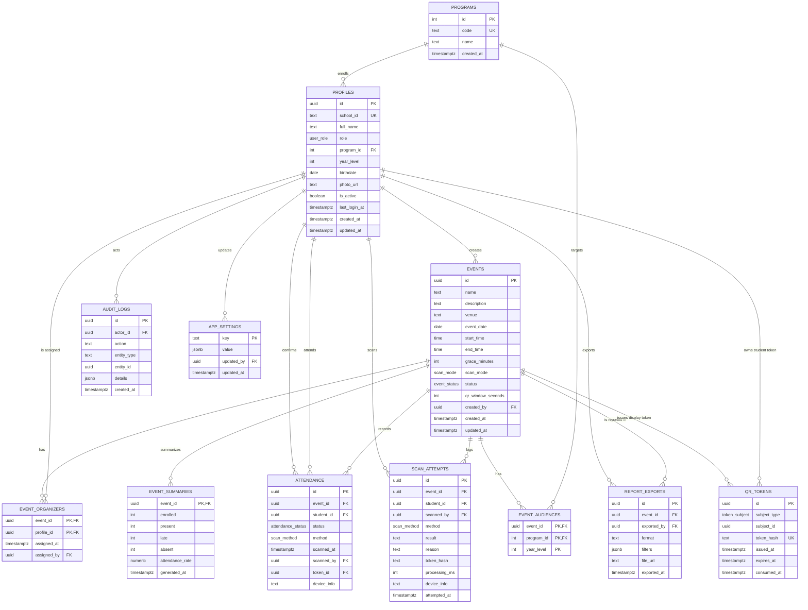

# Data Requirements and Model

This is the working data model for AttendX. It combines:

- the entity list and relationships in the supplied ERD;
- the requirements in `Dynamic QR Attendance.pdf`;
- the Supabase schema already in `supabase/migrations/`;
- the requested **superadmin** role.

Status labels used below:

- **Implemented** — already in `supabase/migrations/0001_schema.sql`.
- **Proposed** — recommended addition; not yet applied.
- **Derived** — calculated at read time; not stored (except summaries).

---

## 1. Data ownership at a glance

| Question | Data owner |
| --- | --- |
| Who can log in? | Supabase Auth (`auth.users`) + `profiles` |
| Who belongs to which program? | `profiles.program_id` |
| What events exist? | `events` |
| Which organizers may scan an event? | `event_organizers` |
| Which students are expected? | `event_audiences` |
| Is a QR code valid right now? | `qr_tokens` |
| Who actually attended? | `attendance` |
| What scans were attempted or rejected? | `scan_attempts` |
| What are the final totals? | `event_summaries` |
| Who exported a report? | `report_exports` (proposed) |
| Who changed sensitive data? | `audit_logs` (proposed) |

---

## 2. Role and data-scope matrix

Legend: **Full** = all rows, **Scoped** = only rows related to the user/assigned
events, **Own** = only the user's own row, **Read** = read-only, **—** = no access.

| Data | Superadmin | Admin | Organizer | Student |
| --- | --- | --- | --- | --- |
| `programs` | Full | Read | Read | Read |
| `profiles` — own | Full | Full | Own | Own |
| `profiles` — students | Full | Full | Read (assigned events) | — |
| `profiles` — admins/organizers | Full | Read | — | — |
| `events` | Full | Full | Read (assigned) | Read (audience) |
| `event_organizers` | Full | Full | Own assignments | — |
| `event_audiences` | Full | Full | Read (assigned) | Read (own program) |
| `attendance` | Full | Full | Scoped (assigned events) | Own |
| `qr_tokens` | Full | Event display only | Event display only | Own student token |
| `scan_attempts` | Full | Full | Scoped (own scans) | — |
| `event_summaries` | Full | Full | Read (assigned) | — |
| `report_exports` | Full | Full | — | — |
| `audit_logs` | Full | — | — | — |
| `app_settings` | Full | Read | — | — |

**Superadmin is new.** The current enum has only `admin`, `organizer`, and
`student`. Admin-only RLS policies must be extended so superadmin is treated as
an admin for event/report access, while admin-account management remains
superadmin-only.

---

## 3. Entity overview

| Entity | Purpose |
| --- | --- |
| `programs` | Academic programs (BSIT, BSBA, BSED, …) used for audiences and student profiles. |
| `profiles` | Application profile for every account. Extends Supabase `auth.users`. |
| `events` | An event, its schedule, grace period, scan mode, and status. |
| `event_organizers` | Which organizer accounts may gatekeeper-scan an event. |
| `event_audiences` | Which programs/year levels are expected at an event. |
| `qr_tokens` | Short-lived rotating tokens for student identity QR and event display QR. |
| `attendance` | One final attendance record per student per event. |
| `scan_attempts` | Audit log of every accepted or rejected scan attempt. |
| `event_summaries` | Frozen totals written when an event is closed. |
| `report_exports` | Audit trail of generated report files. **Proposed.** |
| `audit_logs` | Sensitive admin/superadmin actions. **Proposed.** |
| `app_settings` | Global defaults controlled by superadmin. **Proposed.** |

---

## 4. ERD

> `qr_tokens.subject_id` is polymorphic: it points to a `profiles.id` when
> `subject_type = 'student'`, and to an `events.id` when
> `subject_type = 'event'`. It is intentionally not a single foreign key.

---

## 5. Data dictionary

### 5.1 `programs` — Implemented

| Column | Type | Constraints | Notes |
| --- | --- | --- | --- |
| `id` | `serial` | PK | Integer is fine; programs are a small reference table. |
| `code` | `text` | unique, not null | e.g. `BSIT`. |
| `name` | `text` | not null | e.g. `BS Information Technology`. |
| `created_at` | `timestamptz` | not null, default `now()` | |

### 5.2 `profiles` — Implemented, with proposed fields

One row per application user. Supabase Auth owns email/password; this table owns
the campus profile.

| Column | Type | Constraints | Notes |
| --- | --- | --- | --- |
| `id` | `uuid` | PK, FK `auth.users(id)` on delete cascade | Use the Auth user ID as the profile ID. |
| `school_id` | `text` | unique, not null | Login identifier, e.g. `2023-0142`. |
| `full_name` | `text` | not null | Display name and verification name. |
| `role` | `user_role` | not null, default `student` | Proposed values: `superadmin`, `admin`, `organizer`, `student`. |
| `program_id` | `integer` | FK `programs(id)`, nullable | Null for admins/superadmins; organizers may belong to a program. |
| `year_level` | `integer` | nullable | Used for audience filtering and verification display. |
| `birthdate` | `date` | nullable | Used by the prototype login derivation. Treat as private. |
| `photo_url` | `text` | nullable | Student photo for gatekeeper verification. |
| `is_active` | `boolean` | not null, default `true` | Soft-disable an account. |
| `last_login_at` | `timestamptz` | nullable | **Proposed**; useful for account auditing. |
| `created_at` | `timestamptz` | not null, default `now()` | |
| `updated_at` | `timestamptz` | nullable | **Proposed**; update on profile edits. |

**Not stored here:** `email` and `password_hash`. Supabase Auth stores credentials
in `auth.users`. The synthetic email is derived by the API
(`digits(school_id)@AUTH_EMAIL_DOMAIN`).

### 5.3 `events` — Implemented, with proposed field

| Column | Type | Constraints | Notes |
| --- | --- | --- | --- |
| `id` | `uuid` | PK, default `gen_random_uuid()` | |
| `name` | `text` | not null | Event title. |
| `description` | `text` | nullable | |
| `venue` | `text` | not null | |
| `event_date` | `date` | not null | |
| `start_time` | `time` | not null | Combined with date to compute live/grace windows. |
| `end_time` | `time` | not null | Must be after `start_time`. |
| `grace_minutes` | `integer` | not null, default `15` | Scans after start + grace are `late`. |
| `scan_mode` | `scan_mode` | not null, default `gatekeeper` | `gatekeeper`, `self_service`, or `dual`. |
| `status` | `event_status` | not null, default `scheduled` | `draft`, `scheduled`, `live`, `completed`, `cancelled`. |
| `qr_window_seconds` | `integer` | not null, default `30` | Token TTL for the display and student QR. |
| `created_by` | `uuid` | FK `profiles(id)` | Admin/superadmin who created the event. |
| `created_at` | `timestamptz` | not null, default `now()` | |
| `updated_at` | `timestamptz` | nullable | **Proposed**. |

**Status rule:** the API should treat an event as live when its status is `live`
(or `scheduled`) and the current server time is inside the date/time window. Do
not rely on the status alone, because a scheduled event may start without an
admin toggling it.

### 5.4 `event_organizers` — Implemented, with proposed fields

| Column | Type | Constraints | Notes |
| --- | --- | --- | --- |
| `event_id` | `uuid` | PK, FK `events(id)` on delete cascade | |
| `profile_id` | `uuid` | PK, FK `profiles(id)` on delete cascade | Must have role `organizer` (validate in API). |
| `assigned_at` | `timestamptz` | not null, default `now()` | **Proposed**; ERD includes it. |
| `assigned_by` | `uuid` | FK `profiles(id)`, nullable | **Proposed**; admin who assigned the organizer. |

### 5.5 `event_audiences` — Implemented, with proposed field

Defines the expected audience. An **empty set** for an event means "all programs".

| Column | Type | Constraints | Notes |
| --- | --- | --- | --- |
| `event_id` | `uuid` | PK, FK `events(id)` on delete cascade | |
| `program_id` | `integer` | PK, FK `programs(id)` on delete cascade | Current schema requires a program. |
| `year_level` | `integer` | nullable | **Proposed**; null = all year levels. |

**Recommended semantics**

- `program_id = NULL` and `year_level = NULL` → all programs, all years.
- `program_id = BSIT`, `year_level = NULL` → all BSIT years.
- `program_id = BSIT`, `year_level = 3` → only BSIT third years.

To support "all programs" and multiple year levels cleanly, use a surrogate
`id` primary key and a unique index on
`(event_id, COALESCE(program_id, -1), COALESCE(year_level, -1))`. A simpler
alternative for the MVP is to keep one row per program and omit the "all
programs" row entirely.

### 5.6 `qr_tokens` — Implemented, with proposed security change

| Column | Type | Constraints | Notes |
| --- | --- | --- | --- |
| `id` | `uuid` | PK, default `gen_random_uuid()` | |
| `subject_type` | `token_subject` | not null | `student` or `event`. |
| `subject_id` | `uuid` | not null | Profile ID or event ID, depending on subject type. |
| `token` | `text` | unique, not null | Current raw token. **Replace with `token_hash`.** |
| `issued_at` | `timestamptz` | not null, default `now()` | |
| `expires_at` | `timestamptz` | not null | 30 seconds by default. |
| `consumed_at` | `timestamptz` | nullable | Set when the token is accepted. |

**Token rules**

- Exactly one active token per `(subject_type, subject_id)`. The API deletes or
  invalidates the previous token before inserting a new one.
- Expired or consumed tokens are rejected.
- Store a SHA-256 hash of the token in production, not the raw value. The QR
  contains the raw token; the server hashes the incoming value and looks it up.
- For replay protection across token rotation, keep consumed hashes in a
  `used_tokens` table or keep consumed rows in `qr_tokens` (current behavior).

### 5.7 `attendance` — Implemented, with proposed field

One row per student per event.

| Column | Type | Constraints | Notes |
| --- | --- | --- | --- |
| `id` | `uuid` | PK, default `gen_random_uuid()` | |
| `event_id` | `uuid` | not null, FK `events(id)` on delete cascade | |
| `student_id` | `uuid` | not null, FK `profiles(id)` on delete cascade | Must have role `student`. |
| `status` | `attendance_status` | not null | `present`, `late`, or `absent`. |
| `method` | `scan_method` | nullable | `gatekeeper` or `self_service`; **add `system`** for generated absents. |
| `scanned_at` | `timestamptz` | not null, default `now()` | Actual check-in time (server time). |
| `scanned_by` | `uuid` | FK `profiles(id)`, nullable | Organizer/admin who confirmed; null for self-service. |
| `token_id` | `uuid` | FK `qr_tokens(id)`, nullable | Token used for the accepted scan. |
| `device_info` | `text` | nullable | **Proposed**; scanner device/browser metadata. |

**Constraint:** `UNIQUE (event_id, student_id)` prevents duplicate attendance.
**Derived data:** attendance rate = `(present + late) / enrolled`.

### 5.8 `scan_attempts` — Implemented, aligned to ERD `scan_logs`

| Column | Type | Constraints | Notes |
| --- | --- | --- | --- |
| `id` | `uuid` | PK, default `gen_random_uuid()` | |
| `event_id` | `uuid` | FK `events(id)` on delete cascade, nullable | Null if the event cannot be identified. |
| `student_id` | `uuid` | FK `profiles(id)` on delete set null, nullable | Student identified by the token, if any. |
| `scanned_by` | `uuid` | FK `profiles(id)` on delete set null, nullable | Organizer/admin scanner. |
| `method` | `scan_method` | nullable | `gatekeeper` or `self_service`. |
| `result` | `text` | not null | Current free text; propose enum with the ERD values below. |
| `reason` | `text` | nullable | Detailed rejection reason. |
| `token` | `text` | nullable | Current raw token; **replace with `token_hash`**. |
| `processing_ms` | `integer` | nullable | **Proposed**; supports the <3s metric. |
| `device_info` | `text` | nullable | **Proposed**; browser/device description. |
| `attempted_at` | `timestamptz` | not null, default `now()` | Server receive time. |

**Result values from the ERD:** `accepted`, `cancelled_by_officer`,
`expired_token`, `invalid_token`, `replayed_token`, `duplicate`,
`not_in_audience`, `unauthorized_scanner`, `event_closed`.

Keep a human-readable `reason` for cases such as `student_inactive`,
`wrong_subject`, `missing_token`, or `event_not_live`.

### 5.9 `event_summaries` — Implemented

| Column | Type | Constraints | Notes |
| --- | --- | --- | --- |
| `event_id` | `uuid` | PK, FK `events(id)` on delete cascade | One summary per event. |
| `enrolled` | `integer` | not null, default `0` | Expected audience count. |
| `present` | `integer` | not null, default `0` | |
| `late` | `integer` | not null, default `0` | |
| `absent` | `integer` | not null, default `0` | |
| `attendance_rate` | `numeric(5,2)` | not null, default `0` | Percentage. |
| `generated_at` | `timestamptz` | not null, default `now()` | |

Summaries are generated when an event is closed. Before closing, counts can be
derived live from `attendance`; do not write a summary on every scan.

### 5.10 `report_exports` — Proposed

| Column | Type | Constraints | Notes |
| --- | --- | --- | --- |
| `id` | `uuid` | PK, default `gen_random_uuid()` | |
| `event_id` | `uuid` | FK `events(id)`, nullable | Null for cross-event reports. |
| `exported_by` | `uuid` | FK `profiles(id)` | Superadmin/admin. |
| `format` | `text` | not null | `csv`, `xlsx`, or `pdf`. |
| `filters` | `jsonb` | nullable | Snapshot of the filters used. |
| `file_url` | `text` | nullable | Storage path if the file is retained. |
| `exported_at` | `timestamptz` | not null, default `now()` | |

### 5.11 `audit_logs` — Proposed

| Column | Type | Constraints | Notes |
| --- | --- | --- | --- |
| `id` | `uuid` | PK, default `gen_random_uuid()` | |
| `actor_id` | `uuid` | FK `profiles(id)` | Who performed the action. |
| `action` | `text` | not null | e.g. `event.create`, `user.deactivate`, `report.export`. |
| `entity_type` | `text` | not null | e.g. `event`, `profile`, `report`. |
| `entity_id` | `uuid` | nullable | Affected record. |
| `details` | `jsonb` | nullable | Before/after or extra context. |
| `created_at` | `timestamptz` | not null, default `now()` | |

### 5.12 `app_settings` — Proposed

| Column | Type | Constraints | Notes |
| --- | --- | --- | --- |
| `key` | `text` | PK | e.g. `default_grace_minutes`, `qr_window_seconds`. |
| `value` | `jsonb` | not null | Setting value. |
| `updated_by` | `uuid` | FK `profiles(id)` | Superadmin. |
| `updated_at` | `timestamptz` | not null, default `now()` | |

---

## 6. Derived data (not stored)

These values are computed from `attendance` and event settings:

| Value | Formula / source |
| --- | --- |
| Enrolled | Count of active students matching the event audience. |
| Present | `count(attendance where status = 'present')`. |
| Late | `count(attendance where status = 'late')`. |
| Absent | `enrolled - present - late` (or rows with status `absent` after closing). |
| Attendance rate | `(present + late) / enrolled * 100`. |
| Live/upcoming/completed | Event date + start/end time + status. |
| Late threshold | `start_time + grace_minutes`. |
| QR validity | `consumed_at is null and expires_at > now()`. |

---

## 7. Main data flows

### 7.1 Login

1. Client sends `school_id` and `birthdate`.
2. API derives the synthetic email and password, then calls Supabase Auth.
3. Supabase returns a session.
4. API loads the matching `profiles` row and returns role/profile.
5. Client stores the access/refresh token and routes by role.

### 7.2 Student shows a personal QR

1. Student opens the QR screen.
2. Client requests a student token from `POST /api/tokens/student`.
3. Server invalidates the student's previous token and inserts a new one with a
   30-second expiry.
4. Client renders the token as a QR and refreshes before expiry.
5. Organizer scans it; the server validates it; a new token is issued for the
   next window.

### 7.3 Gatekeeper scan (human-in-the-loop)

1. Organizer scans a student token.
2. Client calls `POST /api/scan/preview` with `{ event_id, token }`.
3. Server validates:
   - event exists and is live;
   - organizer is assigned (or caller is admin);
   - token is a student token, fresh, unused;
   - student exists and is active;
   - audience matches;
   - no duplicate attendance.
4. Server returns the student's photo, name, school ID, program, year level,
   predicted status, and duplicate state.
5. Organizer compares the screen with the person.
6. **Confirm** → `POST /api/scan/confirm` inserts `attendance`, consumes the
   token, and writes an `accepted` scan log.
7. **Cancel** → client discards; server writes a `cancelled_by_officer` log if
   the cancel is reported.

### 7.4 Self-service scan

1. Admin opens the display terminal for a `self_service` or `dual` event.
2. Web app requests an event token every 30 seconds and renders a large QR.
3. Student scans it in the mobile app.
4. Client calls `POST /api/scan/self-checkin` with `{ event_id, token }`.
5. Server validates event mode, liveness, token subject, audience, and duplicate
   state, then inserts `attendance` with method `self_service`.
6. Every rejection is written to `scan_attempts`.

### 7.5 Close event and export

1. Admin closes the event.
2. Server generates missing `absent` rows, counts totals, writes
   `event_summaries`, and marks the event `completed`.
3. Admin filters records and downloads CSV.
4. Server writes a `report_exports` row (and a file in Storage if retained).
5. Add an `audit_logs` entry for the export if audit logging is enabled.

---

## 8. ERD vs. current Supabase schema

| Supplied ERD | Current implementation | Notes |
| --- | --- | --- |
| `users` (`user_id` int, `email`, `password_hash`) | `auth.users` + `profiles` (`id` uuid) | Supabase Auth owns credentials. Cleaner and safer. |
| `users.qr_secret`, `events.display_secret` | `qr_tokens` with `subject_type` | Rotating tokens replace static secrets. Better for screenshot prevention. |
| `event_officers` | `event_organizers` | Same concept, clearer name in the current schema. |
| `attendance_records` | `attendance` | Same fields, plus `token_id`. |
| `scan_logs` | `scan_attempts` | Add `processing_ms` and `device_info` to match the ERD. |
| `used_tokens` | `qr_tokens.consumed_at` | Retaining consumed rows is sufficient; a separate table is optional. |
| `report_exports` | **Missing** | Add when exports are implemented. |
| `events.start_at` / `end_at` | `event_date` + `start_time` / `end_time` | Equivalent; easier for date/time filters. |
| `events.status` (`open`, `closed`) | `scheduled`, `live`, `completed` | More explicit lifecycle. Keep `cancelled`. |
| `attendance.method` (`system`) | `scan_method` has only two values | Add `system` for generated absent rows. |
| `event_audiences.year_level` | **Missing** | Add to support year-specific audiences. |
| `users.last_login_at`, `updated_at` | **Missing** | Add for account auditing and freshness. |
| No superadmin | **Missing** | Add to the enum, RLS, and API. |

---

## 9. Recommended schema changes

Apply these in a new migration (for example `0003_alignment.sql`) before wiring
the superadmin and mobile features.

### Priority 0 — required for the requested scope

1. **Add `superadmin` to `user_role`.**
   - Update `current_role()` consumers and every admin-only RLS policy so
     superadmin passes admin checks.
   - Keep admin-account management restricted to superadmin in the API.
2. **Replace raw token storage with hashes.**
   - Add `token_hash text unique not null`; stop selecting/logging raw tokens.
   - Hash on issue and on validation.
3. **Support year-level audiences.**
   - Add `year_level int` to `event_audiences`.
   - Define null = all years and update `isEnrolled` / audience queries.

### Priority 1 — needed for complete reports and auditability

4. **Add `report_exports`** and write a row on every CSV/PDF/XLSX download.
5. **Add `audit_logs`** for superadmin actions and sensitive admin actions.
6. **Add `system` to `scan_method`** and use it for generated absent rows.
7. **Add `processing_ms` and `device_info`** to `scan_attempts`.
8. **Add `last_login_at` and `updated_at`** to `profiles`, and `updated_at` to
   `events`.

### Priority 2 — nice to have

9. **Add `app_settings`** for global defaults controlled by superadmin.
10. **Add `event_audiences` surrogate key** if "all programs" and multiple year
    levels are needed as first-class rows.
11. **Add notification/reminder tables** only if the thesis scope expands beyond
    attendance.

---

## 10. Constraints and indexes to keep

| Constraint / index | Why |
| --- | --- |
| `profiles.school_id` unique | One account per school ID. |
| `attendance (event_id, student_id)` unique | Prevents duplicate check-ins. |
| `qr_tokens.token_hash` unique | Fast, safe token lookup. |
| `qr_tokens (subject_type, subject_id)` index | Find the active token for a subject. |
| `event_organizers (profile_id)` index | List an organizer's assigned events. |
| `event_audiences (program_id)` index | Audience filtering. |
| `attendance (event_id, status)` index | Live tallies. |
| `scan_attempts (event_id, attempted_at desc)` index | Security/recent-scan views. |
| `events (event_date, status)` index | Dashboard and report filters. |
| `profiles (program_id, role)` index | Enrolled counts and student search. |
| `report_exports (event_id, exported_at desc)` index | Export history. |
| `audit_logs (actor_id, created_at desc)` index | Audit viewer. |

---

## 11. Seed data

The current seed (`supabase/seed.sql` and `backend/scripts/seed.js`) creates:

- Programs: BSIT, BSBA, BSED.
- Accounts: one admin (`ADMIN-0001`), two organizers, five students.
- One sample event using `dual` mode.

The seed is enough to test the API. When the superadmin role is added, add a
separate superadmin account (for example `SUPER-0001`) so the admin account
cannot manage other admins.

---

## 12. Practical rule for developers

When adding a feature, ask:

1. **Which role owns this action?** Check the matrix in section 2.
2. **Which table is the source of truth?** Do not duplicate attendance counts.
3. **Can the client cheat?** Validate tokens, roles, audience, and time on the
   server.
4. **Does it need an audit row?** Sensitive writes and exports should be logged.
5. **Is it derived?** If yes, calculate it; do not store a second copy unless it
   is a frozen summary.
